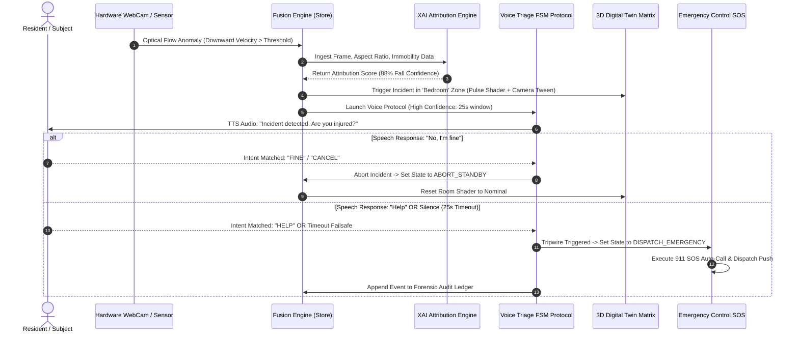

# Application Flow & Navigation Architecture
## Sentinel AI — Routing Sitemap & User Journeys

---

## 1. Application Sitemap Hierarchy

```
Sentinel AI Platform
│
├── Public Landing & Marketing Pages
│   ├── / (Home / Landing Page)
│   ├── /features (Features & Capabilities Overview)
│   ├── /technology (AI & Sensor Fusion Architecture)
│   ├── /about (Mission & Executive Team)
│   └── /contact (Enterprise Inquiries & Support)
│
└── Dashboard Application (/dashboard)
    ├── Overview (/dashboard) [Executive Command Center]
    ├── Risk Intelligence (/dashboard/risk-intelligence) [XAI & 12-Layer Threat Grid]
    ├── Live Monitoring (/dashboard/live-monitoring) [Vision Analytics & Sensor Grid]
    ├── Live Web Camera (/dashboard/live-webcam) [1s Optical Flow Telemetry Stream]
    ├── 3D Digital Twin (/dashboard/digital-twin) [Active 3D Spatial Canvas]
    ├── Incidents (/dashboard/incidents) [SOS Dispatch & Forensic Audit Ledger]
    ├── Analytics (/dashboard/analytics) [Historical Visualizations & Trends]
    ├── Devices (/dashboard/devices) [Hardware Asset Management]
    ├── Reports (/dashboard/reports) [Automated AI Intelligence Briefings]
    ├── Emergency Replay (/dashboard/emergency-replay) [Timeline Playback & AAR]
    ├── Notifications (/dashboard/notifications) [Smart Alert Center]
    ├── AI Assistant (/dashboard/ai-assistant) [Interactive Copilot & Chat]
    ├── Settings (/dashboard/settings) [System Configuration & Rules]
    └── Profile (/dashboard/profile) [User Profile & Access Credentials]
```

---

## 2. Emergency Escalation User Journey



---

## 3. Navigation Scenarios

### Scenario A: Executive Review
1. User logs onto `/dashboard`.
2. Reviews global risk score (34%) and active status badges.
3. Clicks **Risk Intelligence & XAI** card to navigate to `/dashboard/risk-intelligence`.
4. Inspects Bayesian factor attribution and narrative evidence graph.

### Scenario B: Active Incident Response
1. Alert banner appears or user navigates to `/dashboard/digital-twin`.
2. 3D canvas automatically smooth-tweens camera to the affected room mesh with translucent red warning beacon pulsing.
3. User navigates to `/dashboard/incidents` to review the millisecond-timestamped audit ledger or trigger immediate SOS dispatch override.
