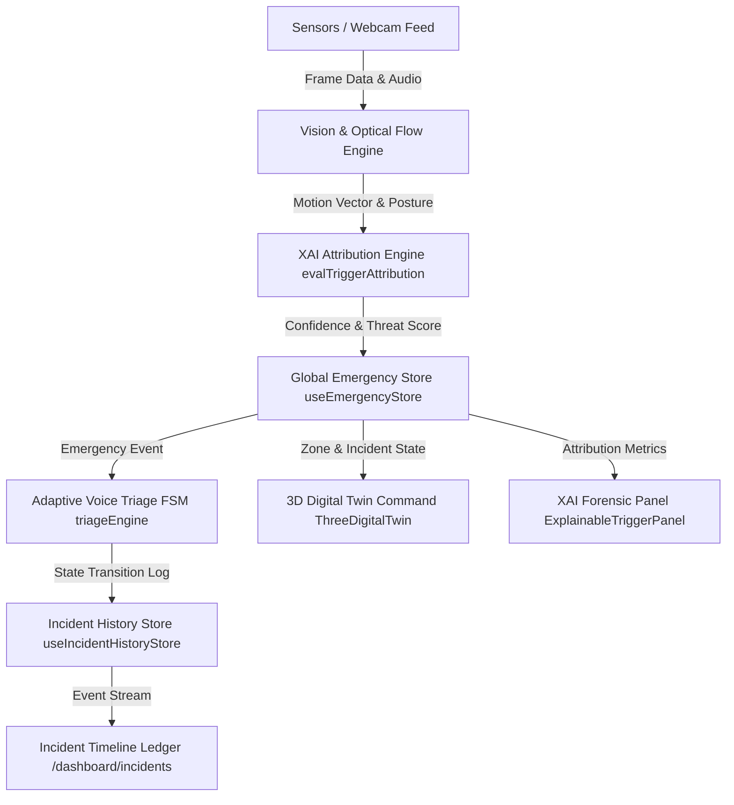

# Technical Requirements Document (TRD)
## Sentinel AI — System Architecture & Engineering Specification

---

## 1. Technology Stack & Frameworks

- **Core Framework**: Next.js 15 (App Router, React 19, TypeScript Strict Mode)
- **Styling & UI**: TailwindCSS v4 (`@theme` inline directive), Lucide React Icons, Framer Motion
- **3D Graphics & Spatial Canvas**: Three.js, `@react-three/fiber`, `@react-three/drei`
- **State Management & Event Bus**: Zustand (`useEmergencyStore`, `useIncidentHistoryStore`), Custom Singleton `EventBus`
- **Speech & Audio**: Web Speech API (`SpeechSynthesis`, `webkitSpeechRecognition`), Synthetic Audio Beep Synthesizer (Web Audio API)
- **Vision & Optical Flow**: HTML5 Canvas 2D Context, Frame Differencing, Centroid Vector Tracking

---

## 2. System Architecture Diagram



---

## 3. Core Module Specifications

### 3.1 Adaptive Triage FSM Engine (`engine/triageEngine.ts`)
```typescript
export type TriageState =
  | 'IDLE'
  | 'PROMPT_STATUS'
  | 'PROMPT_MOBILITY'
  | 'PROMPT_SEVERITY'
  | 'DISPATCH_EMERGENCY'
  | 'ABORT_STANDBY';

export interface EscalationConfig {
  triageCategory: 'LOW' | 'HIGH' | 'CRITICAL';
  verificationWindowSec: number;
  initialPrompt: string;
  autoEscalateOnSilence: boolean;
}
```
- Implements `evaluateEscalationConfig(visionConfidence, postureState, stationaryTimeSec)`
- Computes deterministic next state transitions based on transcript intent matching ("yes", "fine", "no", "help", "can't move").

### 3.2 Explainable AI Attribution Engine (`engine/evalTriggerAttribution.ts`)
Calculates the total risk attribution score using weighted factor vectors:
$$S_{\text{total}} = \sum_{i=1}^{n} w_i \cdot s_i$$
Where factors include:
1. **Vertical Velocity Delta**: Rapid downward displacement of spatial centroid over consecutive frames ($w = 0.25$).
2. **Geometric Aspect Ratio**: Bounding box deformation ($W > 1.15 \times H$) ($w = 0.20$).
3. **Immobility Duration**: Absence of movement post-displacement ($w = 0.25$).
4. **Acoustic Distress Vector**: Presence of distress keywords vs complete silence ($w = 0.15$).
5. **Sector Hazard Multiplier**: Bathroom/Staircase prior weighting ($w = 0.15$).

### 3.3 Event Streaming Store (`store/useIncidentHistoryStore.ts`)
```typescript
export interface IncidentEvent {
  id: string;
  incidentId: string;
  timestamp: string; // HH:mm:ss.SSS
  relativeOffsetSec: number;
  eventType: 
    | 'MOTION_ANOMALY'
    | 'FALL_CLASSIFIED'
    | 'VOICE_VERIFICATION_STARTED'
    | 'SPEECH_INTENT_CAPTURED'
    | 'VERIFICATION_TIMED_OUT'
    | 'ESCALATION_INITIATED'
    | 'DISPATCH_TRIGGERED'
    | 'ABORT_ACKNOWLEDGED';
  severity: 'INFO' | 'WARN' | 'CRITICAL' | 'RESOLVED';
  description: string;
  metadata?: Record<string, unknown>;
}
```

---

## 4. Directory Structure

```
sentinel-ai/
├── app/
│   ├── dashboard/
│   │   ├── digital-twin/page.tsx     # 3D Spatial Incident Command
│   │   ├── incidents/page.tsx        # SOS Control & Forensic Ledger
│   │   ├── live-monitoring/page.tsx  # Vision Analytics & Sensor Grid
│   │   ├── live-webcam/page.tsx      # Optical Flow & 1s Telemetry Stream
│   │   ├── risk-intelligence/page.tsx# Global Risk & XAI Engine
│   │   └── page.tsx                  # Executive Overview Dashboard
├── components/
│   ├── dashboard/
│   │   ├── DigitalTwinView.tsx
│   │   ├── ThreeDigitalTwin.tsx
│   │   ├── ExplainableTriggerPanel.tsx
│   │   ├── EmergencyActionPanel.tsx
│   │   ├── IncidentTimeline.tsx
│   │   ├── VoiceAssistantProtocol.tsx
│   │   └── ...
├── engine/
│   ├── triageEngine.ts
│   └── evalTriggerAttribution.ts
├── store/
│   ├── useEmergencyStore.ts
│   └── useIncidentHistoryStore.ts
└── vision/
    └── streams/
        └── HardwareWebcamOverlay.tsx
```

---

## 5. Verification & Testing Standards

- **TypeScript Compilation**: Clean build with zero errors under `npx tsc --noEmit`.
- **Event Bus Contract**: Strict publishing and listening schemas for `VOICE_ASSISTANT_TRIGGER`, `VOICE_FSM_STATE_CHANGE`, and `FUSION_INCIDENT_TRIGGERED`.
